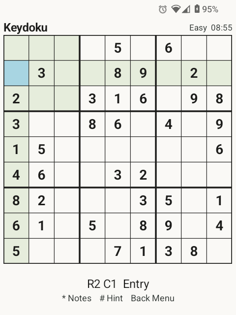

# Keydoku

**Offline Sudoku for Android keypad phones.**

Keydoku is a small, native Sudoku game designed for phones such as the Dumber Mini.
Play with a physical keypad or keyboard, with optional touch selection.
No ads, accounts, analytics, or network permission.

<p>
  <a href="https://github.com/d4mysus/Keydoku/releases">Download APK</a> ·
  <a href="docs/INPUT_MODEL.md">Controls</a> ·
  <a href="keydoku_production/privacy_policy.md">Privacy</a> ·
  <a href="https://github.com/d4mysus/Keydoku/issues">Report an issue</a>
</p>



## Features

- Puzzles with a unique solution in four difficulty levels: Easy, Medium, Hard, and Expert.
- Notes, hints, undo, and redo.
- A timer, per-difficulty statistics, and saved progress.
- Optional mistake checking, cell highlights, sound, and haptic feedback.
- Compact menus and shortcuts designed for small screens.

## Install and update

Requires **Android 6.0 or newer** and a **physical keypad or keyboard**.
Touch selects cells and menu items; there is no on-screen number pad.

Download the signed APK attached to a [GitHub release](https://github.com/d4mysus/Keydoku/releases)
and open it on your phone. Allow installation from your chosen browser or file manager
if Android prompts you. Current-format releases include `keydoku.apk` and `SHA256SUMS`.

For updates through [Obtainium](https://github.com/ImranR98/Obtainium), add:

```text
https://github.com/d4mysus/Keydoku
```

F-Droid submission is planned; Keydoku does not have a confirmed F-Droid listing.
GitHub is the current distribution channel.

## Quick controls

| Key | Action |
| --- | --- |
| D-pad | Move between cells |
| `1`–`9` | Enter a digit or toggle a note |
| `0` / Delete | Clear the selected cell |
| `*` | Toggle notes mode |
| `#` | Fill a hint |
| Volume − / Volume + | Undo / redo |
| Back / Menu | Open the game menu or return to the previous screen |

See the [complete controls guide](docs/INPUT_MODEL.md) for menu shortcuts.

## Privacy and support

Puzzles, notes, settings, and statistics stay on your device. The app disables
cloud backup and device-to-device transfer. Clearing app storage or uninstalling
removes saved progress. See the [privacy policy](keydoku_production/privacy_policy.md).

Keydoku is free. Optional [Buy Me a Coffee donations](https://buymeacoffee.com/d4mysus)
and the in-app Bitcoin option support development and do not unlock features.

For bugs or suggestions, [open an issue](https://github.com/d4mysus/Keydoku/issues).
Include your phone model, Android version, app version, and steps to reproduce.

## Build from source

Use JDK 21, Android SDK platform 37.0, and Build Tools 36.0.0.
The included wrapper provides Gradle 9.4.1; a separate Gradle installation is unnecessary.

```sh
./gradlew test lintRelease assembleDebug
```

The debug APK is at `app/build/outputs/apk/debug/app-debug.apk`.
Use a debug build for development; distribution APKs use the permanent release key.

- [Development and device testing](docs/DEVELOPMENT.md)
- [Signed releases and Obtainium](docs/DISTRIBUTION.md)
- [Architecture](docs/ARCHITECTURE.md)
- [Sudoku engine](docs/SUDOKU_ENGINE.md)
- [Changelog](CHANGELOG.md)
- [Contributing](CONTRIBUTING.md)

## License

Keydoku is licensed under [GPL-3.0-only](LICENSE).
The APK includes the GPL and notices for its Apache-2.0 dependencies.
